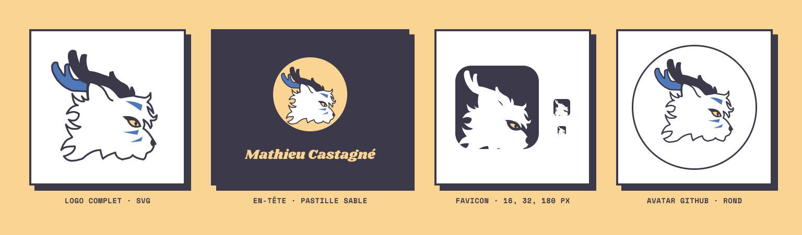
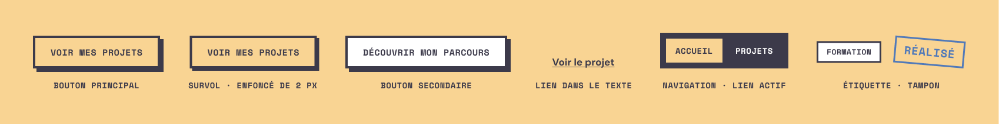

# AP1 - Portfolio - Charte graphique

**Date de création :** 24/11/2026 - M. Castagné

**Date de modification :** 24/11/2026 - M. Castagné

**Version :** 0.1

**Sommaire :**

> [TOC]

## 1. Contexte du projet

Ce document présente la charte graphique de mon portfolio, réalisé dans le cadre de l’atelier de professionnalisation 1 du BTS Services informatiques aux organisations (SIO), option Solutions d’infrastructure, systèmes et réseaux (SISR). Ce site a pour but de présenter mon profil d’étudiant en alternance, mon parcours, mes projets et ma veille technologique à de futurs employeurs comme au jury du BTS. La charte s’adresse au prestataire chargé de la mise en forme du site en HTML et CSS. Elle lui fournit tous les éléments nécessaires pour réaliser chaque page sans avoir à deviner : les couleurs, les polices, le logo et les composants, les maquettes de chaque page sur ordinateur et sur mobile, ainsi que la logique de navigation.

## 2. Explication de l’identité visuelle

Le portfolio associe deux influences. Sa structure est brutaliste, comme le béton brut des bâtiments administratifs des années 70 : angles droits, bordures épaisses, ombres pleines et décalées, étiquettes et boutons dans une police à chasse fixe qui rappelle les anciens terminaux. Sa voix vient de la pop de la même époque : couleurs franches posées en aplats, titres à la typographie « groovy », arc-en-ciel et cercles concentriques. À cela s’ajoutent des touches rétrofuturistes inspirées de l’univers administratif de la série Loki : fiches de dossier et tampons pour présenter les projets, écran cathodique pour la veille technologique, arches empruntées à l’architecture de cette époque.

Ce choix répond à deux intentions. D’abord, je voulais un site rigoureux dans sa forme et chaleureux dans sa voix, que l’on reconnaît au premier coup d’œil, loin des portfolios sobres et interchangeables. Ensuite, cet univers de bureau où tout est classé, documenté et horodaté rejoint mon métier : au support informatique, je traite des tickets, je rédige des procédures et je documente mes interventions. La structure nette reflète cette rigueur. La typographie et les couleurs, elles, rappellent un parcours commencé dans l’accueil et la relation client.

L’emblème du site est Djed, un tigre-cerf, personnage original que j’ai créé. Dessiné en aplats avec des contours épais, dans l’esprit des dessins animés des années 70, il s’intègre naturellement à cette identité et donne au portfolio une signature personnelle. Animé au centre de l’arc-en-ciel sur la page d’accueil, il accueille le visiteur, puis l’accompagne sur chaque page, dans l’en-tête.

Le style reste au service du contenu : la décoration habille les titres, les séparations et les illustrations, jamais les textes à lire.

## 3. Éléments de déclinaison de l’identité visuelle

### 3.1. Couleurs

### 3.1. Couleurs

La palette compte quatre couleurs, toujours utilisées en aplats, sans dégradé ni transparence.

| Couleur | Hexadécimal | RVB | Rôle | Exemples d’usage |
| --- | --- | --- | --- | --- |
| Sable | `#F9D493` | 249, 212, 147 | Fond principal, couleur « soleil » | Fond des pages, grands titres sur bleu, boutons principaux |
| Anthracite | `#3C3A4A` | 60, 58, 74 | Texte, contours et ombres | Texte courant, en-tête, pied de page, bordures, ombres décalées, introduction de la page Veille |
| Bleu | `#5079B9` | 80, 121, 185 | Accent | Accueil, barres sous les titres, tampons de statut, cadre de l’écran de la page Veille |
| Blanc | `#FFFFFF` | 255, 255, 255 | Respiration | Cartes, section Projets, bandes de rayures |

Les sections alternent leurs fonds (sable, bleu, blanc, anthracite) pour marquer le passage d’une partie à l’autre sans séparateur supplémentaire.

**Contrastes**

Les associations de couleurs respectent le niveau AA des règles d’accessibilité WCAG 2.1 : un contraste d’au moins 4,5:1 pour le texte courant et de 3:1 pour le grand texte (24 px, ou 19 px en gras).

| Texte / fond | Contraste | Usage autorisé |
| --- | --- | --- |
| Anthracite sur blanc, ou blanc sur anthracite | 11,1:1 | Tout texte |
| Anthracite sur sable, ou sable sur anthracite | 7,8:1 | Tout texte |
| Blanc sur bleu, ou bleu sur blanc | 4,4:1 | Grand texte uniquement |
| Sable sur bleu, ou bleu sur sable | 3,1:1 | Grand texte uniquement |
| Anthracite sur bleu | 2,5:1 | À éviter pour du texte |
| Sable sur blanc | 1,4:1 | Décoration uniquement |

### 3.2. Typographie

Le site utilise trois polices, chacune avec un rôle précis :

- **Shrikhand**, pour les titres : c’est la voix « groovy » des années 70, réservée aux titres et jamais utilisée pour un texte à lire ;
- **Space Mono** (Bold), pour les éléments d’interface : navigation, boutons, étiquettes, dates et tampons, toujours en majuscules. Sa chasse fixe rappelle les anciens terminaux ;
- **DM Sans**, pour tous les textes à lire, choisie pour sa lisibilité à l’écran.

| Élément | Police | Ordinateur | Mobile | Particularités |
| --- | --- | --- | --- | --- |
| Nom sur la page d’accueil | Shrikhand | 104 px | 56 px | Sable sur bleu, ombre en escalier anthracite (3, 6 et 9 px), interligne 100 % |
| Titres de page | Shrikhand | 60 px | 40 px | Suivis d’une barre de 120 × 10 px, interligne 112 % |
| Titres de carte | Shrikhand | 28 px | 24 px | Interligne 115 % |
| Nom dans l’en-tête | Shrikhand | 26 px | 20 px | Sable sur anthracite |
| Navigation | Space Mono Bold | 14 px | 12 px | Majuscules, espacement des lettres 4 % |
| Boutons | Space Mono Bold | 15 px | 14 px | Majuscules, espacement des lettres 4 % |
| Étiquettes et dates | Space Mono Bold | 12 à 16 px | 12 à 14 px | Majuscules, espacement des lettres 4 % |
| Tampons de statut | Space Mono Bold | 19 px | 19 px | Bleu sur sable : 19 px minimum pour le contraste |
| Présentation de l’accueil | DM Sans Bold | 22 px | 19 px | Blanc sur bleu : le gras est obligatoire pour le contraste |
| Sous-titres de carte | DM Sans Bold | 23 à 24 px | 20 à 21 px | Interligne 125 % |
| Texte d’introduction | DM Sans Regular | 20 px | 17 px | Interligne 165 % |
| Texte courant | DM Sans Regular | 17 à 18 px | 16 px | Interligne 160 à 165 % |
| Liens dans le texte | DM Sans Bold | 16 à 17 px | 16 px | Soulignés |

Entre le format mobile et le format ordinateur, les tailles évoluent progressivement avec la largeur de l’écran.

**Intégration**

Les trois polices proviennent de Google Fonts et sont distribuées sous licence libre SIL Open Font License 1.1, qui autorise leur utilisation sur un site. Elles sont hébergées directement avec le site, au format WOFF2, dans le dossier `html/assets/fonts`, plutôt que chargées depuis les serveurs de Google : ainsi, l’adresse IP des visiteurs n’est pas transmise à un tiers.

Polices de secours, si une police ne se charge pas :

- titres : `'Shrikhand', Georgia, serif` ;
- interface : `'Space Mono', 'Courier New', monospace` ;
- texte : `'DM Sans', system-ui, sans-serif`.

### 3.3. Logo, icônes et boutons

### 3.3. Logo, icônes et boutons

#### Logo

Le logo représente Djed, un tigre-cerf vu de profil, tourné vers la droite. Il est dessiné en aplats, avec des contours anthracite épais : fourrure blanche, bois avant anthracite, bois arrière et marques de tigre bleus, œil sable.

| Version | Fichier | Usage | Taille |
| --- | --- | --- | --- |
| Logo complet | `djed-logo.svg` | Page d’accueil (version animée), pastille de l’en-tête | 48 px minimum |
| Pastille de l’en-tête | Logo complet dans un cercle sable bordé d’anthracite (4 px) | En-tête de toutes les pages | 64 px sur ordinateur, 48 px sur mobile |
| Favicon | `favicon.svg`, `favicon.ico`, `apple-touch-icon.png` | Onglet du navigateur, raccourci sur mobile | 16, 32 et 180 px |
| Avatar | `djed-avatar-512.png` | Photo de profil GitHub | 512 px |

Règles d’utilisation :

- le logo complet se pose toujours sur un fond clair, sable ou blanc. Sur un fond anthracite, il est placé dans la pastille sable, sinon le bois avant et les contours disparaissent ;
- en dessous de 48 px, on utilise le favicon, conçu pour les petites tailles ;
- un espace libre d’au moins 10 % de sa largeur est laissé autour du logo ;
- le logo n’est jamais déformé, recoloré, retourné (Djed regarde toujours vers la droite), ni orné d’une ombre ou d’un dégradé ;
- dans l’en-tête, son texte alternatif est « Logo de Mathieu Castagné, retour à l’accueil ».

Sur la page d’accueil, le logo est animé. Le fichier SVG est intégré directement dans le code HTML, et non appelé par une balise `img`, pour que la feuille de style puisse cibler ses calques : `paupiere`, `pupille`, `bois-avant`, `bois-arriere`… L’animation reste discrète (clignement de la paupière, léger balancement des bois) et se désactive pour les visiteurs qui ont réduit les animations dans leur système (`prefers-reduced-motion`).

#### Icônes

Le site n’utilise que deux icônes, LinkedIn et GitHub, dans le pied de page. Ce sont les icônes officielles fournies par ces deux services, en version monochrome blanche, de 20 px, accompagnées du nom du réseau. Leur texte alternatif est celui défini dans le document de contenu.

Si d’autres icônes deviennent nécessaires, elles seront dessinées au trait, de la couleur du texte. Les emojis et les icônes en couleur sont exclus.

#### Boutons et liens

| Élément | Apparence | Au survol |
| --- | --- | --- |
| Bouton principal | Fond sable, texte anthracite en Space Mono Bold 15 px majuscules, bordure anthracite de 4 px, angles droits, ombre pleine décalée de 6 px, marges intérieures de 13 × 26 px | Le bouton « s’enfonce » : il glisse de 2 px vers le bas et la droite, et son ombre passe à 4 px |
| Bouton secondaire | Identique au bouton principal, sur fond blanc | Identique au bouton principal |
| Lien dans le texte | DM Sans Bold, anthracite, souligné | Soulignement plus épais |
| Lien de navigation | Space Mono Bold 14 px, majuscules, blanc sur anthracite | Fond sable et texte anthracite, comme le lien de la page active |
| Sélecteur de langue | FR / EN dans un cadre bordé de sable | La langue active a un fond sable |
| Étiquette | Space Mono Bold 12 à 14 px, majuscules, fond blanc, bordure anthracite de 3 px | Pas d’interaction |
| Tampon de statut | Space Mono Bold 19 px, majuscules, bleu, bordure bleue de 3 px, inclinée de 5° | Pas d’interaction |

Accessibilité :

- quand un élément est sélectionné au clavier, il reçoit un contour de 3 px : bleu sur un fond clair, sable sur un fond anthracite ;
- sur mobile, les boutons et les liens de navigation mesurent au moins 44 px de haut, pour rester faciles à toucher.

## 4. Maquettage responsive de chaque page

### 4.1. Accueil

#### Version ordinateur

#### Version mobile

### 4.2. Parcours

### 4.3. Projets

### 4.4. Projets AP3 et AP4

### 4.5. Veille technologique

### 4.6. Mentions légales

### 4.7. Plan du site

## 5. Logique de navigation dans le site