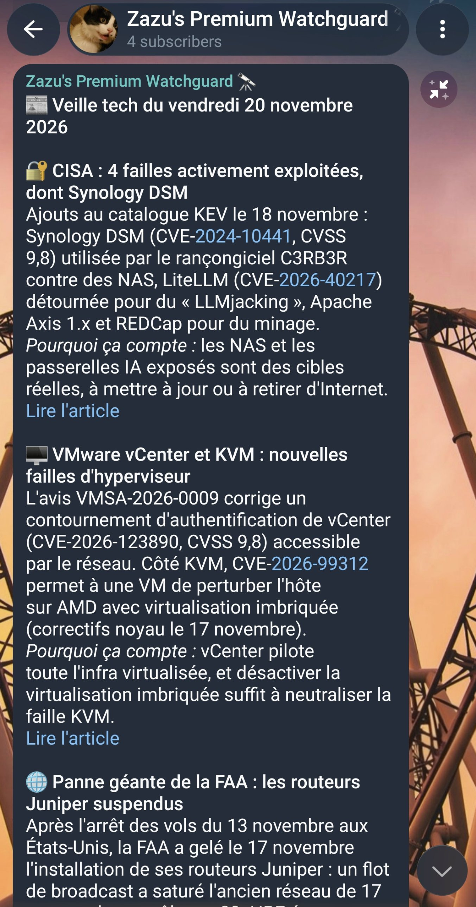
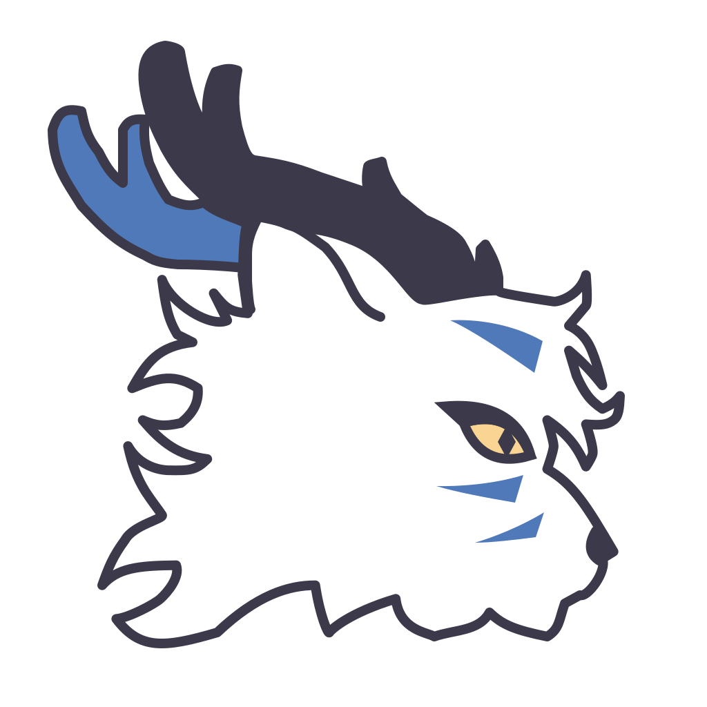
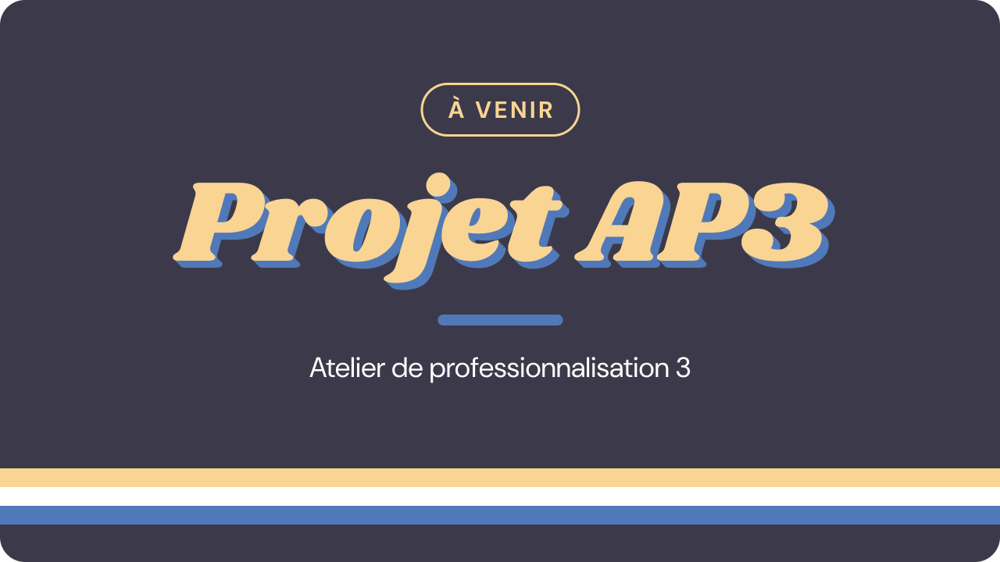
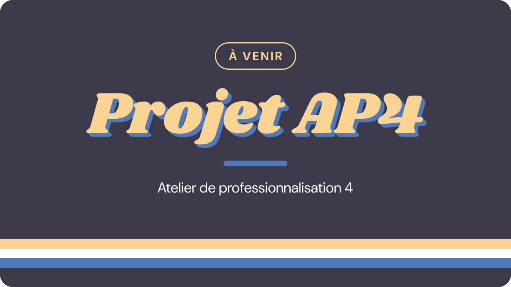
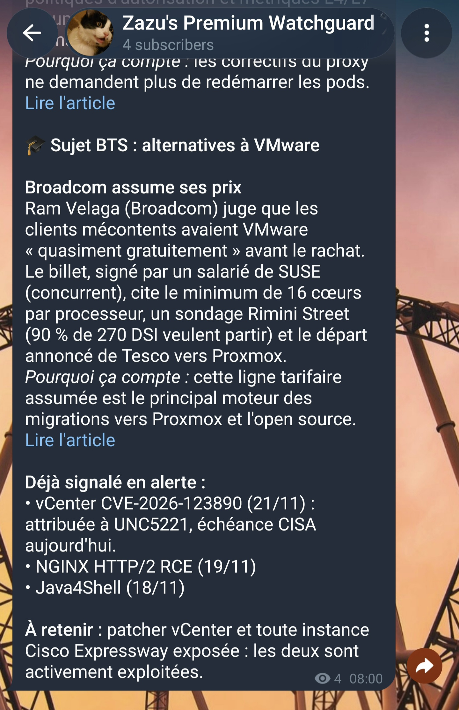

# AP1 - Portfolio - Contenu

**Date de création :** 16/10/2026 - M. Castagné

**Date de modification :** 23/11/2026 - M. Castagné

**Version :** 0.5

**Sommaire :**

> [TOC]

## 1. Gabarit commun

### 1.1. En-tête

**Titre :** Logo de Mathieu Castagné (lien vers la page Accueil)

**Alt :** Logo de Mathieu Castagné, retour à l’accueil

**Barre de navigation :**

- Accueil (lien vers la page Accueil)
- Projets (lien vers la page Projets)
- Parcours (lien vers la page Parcours)
- Veille technologique (lien vers la page Veille technologique)

**Sélecteur de langue :** FR (Français) / EN (English)

### 1.2. Pied de page

**Liens du site :**

- Plan du site (lien vers la page Plan du site)
- Mentions légales (lien vers la page Mentions légales)

**Réseaux :**

- LinkedIn (lien vers mon profil LinkedIn), texte alternatif : Profil LinkedIn de Mathieu Castagné
- GitHub (lien vers mon profil GitHub), texte alternatif : Profil GitHub de Mathieu Castagné

**Copyright :** © 2026 Mathieu Castagné

## 2. Accueil

### 2.1. Textes

**Titre principal :** Mathieu Castagné - Portfolio

**Présentation :** Je suis étudiant en BTS Services informatiques aux organisations (SIO), option Solutions d’infrastructure, systèmes et réseaux (SISR), en alternance chez MAN Truck & Bus.

**Bouton principal :** Voir mes projets (lien vers la page Projets)

**Bouton secondaire :** Découvrir mon parcours (lien vers la page Parcours)

### 2.2. Illustrations

**Illustration 1 :**

- Titre : Logo animé de Mathieu Castagné
- Alt : Logo de Mathieu Castagné, un tigre-cerf en mouvement

## 3. Parcours

### 3.1. Textes

**Titre principal :** Parcours

**Introduction :** Titulaire d’un bac pro Accueil relation clients et usagers, j’ai passé cinq ans à la réception d’un hôtel parisien, à accueillir, écouter et accompagner les clients au quotidien. Après une période de réflexion, j’ai choisi de me réorienter vers l’informatique, un domaine que je pratiquais déjà en autodidacte. Ma mission d’intérim chez MAN Truck & Bus, prévue pour deux mois, a été renouvelée trois fois, puis l’entreprise m’a accordé sa confiance en me proposant un contrat d’apprentissage pour poursuivre mes études. Au support informatique, je mets chaque jour à profit le sens de la relation client, l’empathie et la gestion du stress et des conflits acquis dans l’hôtellerie.

**Expériences professionnelles :**

- Apprenti technicien informatique, MAN Truck & Bus, Évry-Courcouronnes (depuis août 2026)
- Technicien support niveau 2, MAN Truck & Bus, Évry-Courcouronnes (août 2025 - juillet 2026)
- Réceptionniste, hôtellerie, Paris 13e (2018 - 2023)

**Engagement associatif :**

- Cofondateur, secrétaire et membre du conseil d’administration, AnthroTales Events (ASBL), Belgique (depuis août 2024)

  Association qui organise chaque année une convention consacrée aux animaux anthropomorphiques, réunissant un public francophone et européen (plus de 200 participants lors de la première édition, 300 attendus pour la deuxième).

  - Supervision de 4 responsables d’équipe (médias, espace exposants, contenus éditoriaux et relations hôtelières), soit 23 bénévoles au total
  - Négociation du contrat avec l’hôtel partenaire (environ 130 chambres), auprès de ses responsables événementiel et hébergement : tarif des nuitées, prestations incluses et location des salles
  - Gestion des produits dérivés auprès des fabricants : cahier des charges, comparaison de devis selon plusieurs scénarios de quantités, et traitement des réclamations en cas de produits non conformes
  - Organisation de l’espace exposants : appel à candidatures, sélection (12 exposants pour la première édition, 16 pour la deuxième), plan de salle et collecte des documents administratifs
  - Coprésentation des cérémonies d’ouverture et de clôture devant 213 personnes (première édition), en binôme français-anglais, et préparation du support de présentation en anglais

**Formations :**

- BTS Services informatiques aux organisations (SIO), option Solutions d’infrastructure, systèmes et réseaux (SISR), CCI Campus Strasbourg, Strasbourg (2026 - 2028, en cours)
- Titre professionnel Technicien d’assistance en informatique (TAI), AFPA, Créteil (juin 2024 - janvier 2025, obtenu)
- Baccalauréat professionnel Accueil relation clients et usagers, Lycée des métiers Jean Monnet, Juvisy-sur-Orge (2018, mention Bien)

### 3.2. Illustrations

**Illustration 1 :**

- Titre : Photo de Mathieu Castagné
- Alt : Mathieu Castagné souriant, en tenue professionnelle

**Illustration 2 :**

- Titre : Frise chronologique du parcours
- Alt : Frise chronologique du parcours scolaire, professionnel et associatif de Mathieu Castagné depuis 2018, détaillé dans le texte de la page

## 4. Projets

### 4.1. Textes

**Titre principal :** Projets

**Introduction :** Voici un aperçu de mes projets informatiques, réalisés, en cours ou à venir.

**Projet 1 :**

- Titre : Bot Telegram de veille technologique « Zazu’s Premium Watchguard »
- Statut : Réalisé
- Présentation : Un système de veille automatisé, piloté par l’agent d’intelligence artificielle (IA) Claude, d’Anthropic, qui envoie chaque lundi et vendredi sur Telegram, dans un canal, une synthèse de l’actualité informatique sur cinq thèmes : cybersécurité, réseau, systèmes, cloud et IA, matériel. J’ai conçu son fonctionnement et rédigé les consignes de l’agent, notamment la vérification des dates et des sources de chaque article. J’ai créé le bot Telegram avec BotFather et relié l’agent à ce bot grâce à Zapier. Un journal enregistré sur Google Drive garde la trace des informations déjà envoyées, pour éviter les doublons.

**Projet 2 :**

- Titre : Portfolio étudiant (AP1)
- Statut : En cours
- Présentation : Conception complète de ce portfolio dans le cadre de l’atelier de professionnalisation 1 du BTS SIO : rédaction des contenus, création de la charte graphique, du logo et des maquettes, développement en HTML, CSS et JavaScript, et gestion de versions avec Git. Le développement s’effectue dans une machine virtuelle Ubuntu créée avec Multipass.

**Projet 3 :**

- Titre : Projet AP3
- Statut : À venir
- Présentation : Projet qui sera réalisé dans le cadre de l’atelier de professionnalisation 3 du BTS SIO. Sa présentation détaillée sera disponible sur sa page dédiée.
- Lien : Voir le projet (lien vers la page Projet AP3)

**Projet 4 :**

- Titre : Projet AP4
- Statut : À venir
- Présentation : Projet qui sera réalisé dans le cadre de l’atelier de professionnalisation 4 du BTS SIO. Sa présentation détaillée sera disponible sur sa page dédiée.
- Lien : Voir le projet (lien vers la page Projet AP4)

### 4.2. Illustrations

**Illustration 1 :**

- Titre : Capture d’écran du bot Telegram de veille technologique
- Alt : Capture d’écran du bot Telegram Zazu’s Premium Watchguard montrant une synthèse de veille technologique, avec des actualités classées par thème

**Illustration 2 :**

- Titre : Logo de Mathieu Castagné
- Alt : Logo de Mathieu Castagné, un tigre-cerf, emblème du portfolio

**Illustration 3 :**

- Titre : Encart « Projet à venir » (AP3)
- Alt : Projet AP3 à venir

**Illustration 4 :**

- Titre : Encart « Projet à venir » (AP4)
- Alt : Projet AP4 à venir

## 5. Projet AP3

### 5.1. Textes

**Titre principal :** Projet AP3 (titre définitif à venir)

**Présentation :** présentation du projet (à compléter lors de l’atelier de professionnalisation 3)

**Compétences du référentiel mobilisées :** liste des compétences du BTS SIO mises en œuvre (à compléter lors de l’atelier de professionnalisation 3)

**Documents de présentation :** liens vers les documents présentant la réalisation (à compléter lors de l’atelier de professionnalisation 3)

**Documentations :** liens vers la documentation technique et la documentation utilisateur (à compléter lors de l’atelier de professionnalisation 3)

**Lien de retour :** Retour aux projets (lien vers la page Projets)

### 5.2. Illustrations

**Illustration 1 :**

- Titre : Encart « Projet à venir » (AP3)
- Alt : Projet AP3 à venir

## 6. Projet AP4

### 6.1. Textes

**Titre principal :** Projet AP4 (titre définitif à venir)

**Présentation :** présentation du projet (à compléter lors de l’atelier de professionnalisation 4)

**Compétences du référentiel mobilisées :** liste des compétences du BTS SIO mises en œuvre (à compléter lors de l’atelier de professionnalisation 4)

**Documents de présentation :** liens vers les documents présentant la réalisation (à compléter lors de l’atelier de professionnalisation 4)

**Documentations :** liens vers la documentation technique et la documentation utilisateur (à compléter lors de l’atelier de professionnalisation 4)

**Lien de retour :** Retour aux projets (lien vers la page Projets)

### 6.2. Illustrations

**Illustration 1 :**

- Titre : Encart « Projet à venir » (AP4)
- Alt : Projet AP4 à venir

## 7. Veille technologique

### 7.1. Textes

**Titre principal :** Veille technologique

**Problématique :** Quelles alternatives open source s’offrent aux entreprises pour remplacer VMware dans leurs infrastructures de virtualisation, après son rachat par Broadcom ?

**Pourquoi ce sujet :** Utilisateur au quotidien d’alternatives aux géants du numérique, comme Linux à la place de Windows ou la suite Proton à la place de Google Workspace, je suis attentif à la protection et à la souveraineté de mes données. Beaucoup d’entreprises européennes dépendent d’éditeurs américains, soumis à des lois comme le CLOUD Act (2018). Le rachat de VMware par Broadcom, suivi de fortes hausses de prix, illustre ce risque de dépendance et pousse de nombreuses entreprises à chercher d’autres solutions. En tant que futur technicien systèmes et réseaux, je souhaite comparer et analyser les alternatives à VMware, pour savoir accompagner une entreprise dans sa migration.

**Méthode de veille :** Ma veille repose sur deux volets. D’abord, un bot Telegram que j’ai conçu publie automatiquement, chaque lundi et vendredi, une synthèse de l’actualité informatique dans un canal public que je partage autour de moi ; une section y est consacrée à mon sujet de veille, et chaque information est archivée dans un journal. Je complète cette veille automatisée en consultant des sites spécialisés comme IT-Connect et les blogs officiels de Proxmox et de Vates, et en suivant des articles d’experts sur LinkedIn.

**Synthèse :** Depuis son rachat par Broadcom fin 2023, VMware a abandonné les licences perpétuelles au profit d’abonnements groupés facturés au cœur, ce qui a fait grimper la facture de nombreux clients, de 25 % à plus de 100 % selon les cas. Face à ces hausses, plusieurs alternatives open source reviennent régulièrement dans ma veille : Proxmox VE (basé sur KVM), la plus citée, XCP-ng avec Xen Orchestra, portée par l’éditeur français Vates, et KubeVirt, notamment à travers OpenShift Virtualization, pour les entreprises déjà orientées Kubernetes. Pourtant, beaucoup d’entreprises qui envisagent de partir ne franchissent pas le pas, freinées par la complexité de la migration, la compatibilité des outils de sauvegarde et de stockage, la montée en compétence des équipes et des contrats souvent engagés sur plusieurs années. Broadcom complique aussi la sortie : depuis fin août 2026, le kit VDDK, utilisé par les outils de migration tiers, n’est plus téléchargeable publiquement. À ce stade, la migration semble surtout concerner les PME, et je reste prudent sur les chiffres, car une bonne partie provient d’études financées par des concurrents de VMware. Cette synthèse sera enrichie au fil de ma formation, à mesure que ma veille avancera et que je pourrai tester moi-même ces alternatives.

### 7.2. Illustrations

**Illustration 1 :**

- Titre : Capture d’écran du canal Telegram de veille technologique
- Alt : Capture d’écran du canal Telegram Zazu’s Premium Watchguard montrant la section « Sujet BTS : alternatives à VMware » d’une synthèse de veille

## 8. Mentions légales

### 8.1. Textes

**Titre principal :** Mentions légales

**Éditeur du site :** coordonnées du propriétaire du site (texte rédigé dans le cadre du Rendu 3)

**Hébergeur :** coordonnées de l’hébergeur du site (texte rédigé dans le cadre du Rendu 3)

**Propriété intellectuelle :** mentions relatives aux droits sur les textes, le logo et les illustrations (texte rédigé dans le cadre du Rendu 3)

**Données personnelles :** mentions relatives à la collecte et au traitement des données personnelles (texte rédigé dans le cadre du Rendu 3)

### 8.2. Illustrations

Aucune illustration prévue pour cette page.

## 9. Plan du site

### 9.1. Textes

**Titre principal :** Plan du site

**Liens :**

- Accueil (lien vers la page Accueil)
- Projets (lien vers la page Projets)
  - Projet AP3 (lien vers la page Projet AP3)
  - Projet AP4 (lien vers la page Projet AP4)
- Parcours (lien vers la page Parcours)
- Veille technologique (lien vers la page Veille technologique)
- Mentions légales (lien vers la page Mentions légales)

### 9.2. Illustrations

Aucune illustration prévue pour cette page.
