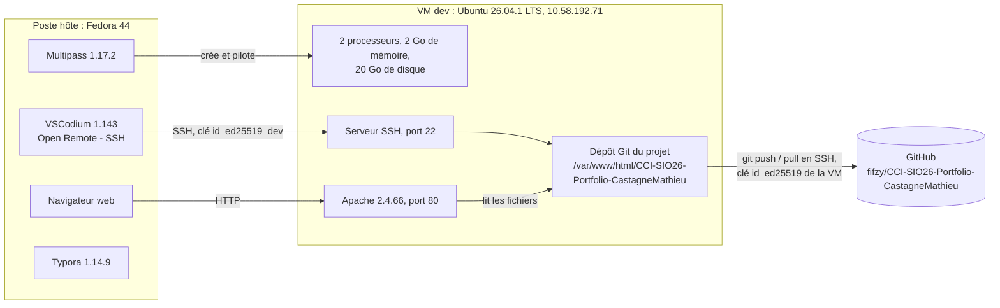

# AP1 - Portfolio - Documentation technique

**Date de création :** 25/11/2026 - M. Castagné

**Date de modification :** 27/11/2026 - M. Castagné

**Version :** 1.0

**Sommaire :**

> [TOC]

<div style="page-break-after:always"></div>

## 1. Objet du document

Ce document décrit l’environnement technique utilisé pour réaliser mon portfolio dans le cadre de l’atelier de professionnalisation 1 du BTS SIO. Il s’adresse à un technicien qui reprendrait le projet : il liste les technologies et les versions des logiciels, décrit l’architecture de l’environnement de développement, justifie le choix de chaque outil et donne la procédure pour reconstruire cet environnement à l’identique.

Les versions indiquées ont été relevées le 25/11/2026. En fin de projet, ce document sera complété par la description de l’environnement de production et par la procédure de mise en ligne du site.

## 2. Technologies et versions

### 2.1. Langages et formats

| Technologie | Usage dans le projet |
| --- | --- |
| HTML5 | Structure des pages du site |
| CSS3 | Mise en forme et adaptation à toutes les tailles d’écran (responsive) |
| JavaScript | Petites interactions dans le navigateur, en JavaScript natif, sans bibliothèque ni framework |
| SVG | Logo animé, icônes LinkedIn et GitHub |
| WOFF2 | Polices Shrikhand, Space Mono et DM Sans, hébergées avec le site |
| Markdown | Documentation du projet : contenu, charte graphique et documentation technique |

Le site est statique : il n’utilise ni base de données ni langage côté serveur, et n’a besoin d’aucun outil de compilation (ni npm, ni framework). Les fichiers du dossier `html` sont servis tels quels. Ce choix limite le nombre de dépendances à maintenir et réduit la surface d’attaque.

Tous les fichiers sont encodés en UTF-8, avec des fins de ligne au format Unix (LF).

### 2.2. Logiciels

| Logiciel | Rôle | Version | Emplacement | Installation |
| --- | --- | --- | --- | --- |
| Fedora Linux | Système du poste de travail | 44 (noyau 7.2.15) | Hôte | - |
| Multipass | Création et gestion de la machine virtuelle | 1.17.2 | Hôte | Snap, canal `latest/stable` |
| VSCodium | Éditeur de code | 1.143.17232 | Hôte | Flatpak, dépôt Flathub |
| Open Remote - SSH | Extension de VSCodium pour travailler directement dans la VM | Dernière version | Hôte | Open VSX, depuis VSCodium |
| Typora | Relecture des documents markdown et export en PDF | 1.14.9 | Hôte | Flatpak, dépôt Flathub |
| Git | Suivi de version | 2.56.1 | Hôte | dnf |
| OpenSSH (client) | Connexion à la VM | 10.2p1 | Hôte | dnf |
| Ubuntu Server | Système de la VM | 26.04.1 LTS (noyau 7.0.0) | VM | Image officielle fournie par Multipass |
| Apache HTTP Server | Serveur web de développement | 2.4.66 | VM | apt |
| Git | Suivi de version, échanges avec GitHub | 2.55.0 | VM | apt |
| OpenSSH (serveur) | Accès à distance à la VM | Version d’Ubuntu 26.04 | VM | Préinstallé |
| PHP | Installé dans la VM, non utilisé par le portfolio | 8.5.4 | VM | apt |

Le code source est hébergé sur GitHub, dans le dépôt `fifzy/CCI-SIO26-Portfolio-CastagneMathieu`, sur la branche `main`.

<div style="page-break-after:always"></div>

## 3. Architecture de l’environnement de développement

Le développement se fait dans une machine virtuelle (VM) Ubuntu nommée `dev`, créée avec Multipass sur le poste Fedora. Les fichiers du projet sont stockés dans la VM, dans le dossier servi par Apache.

- **Édition :** VSCodium, lancé sur l’hôte, ouvre ce dossier à distance par SSH. L’édition, le terminal intégré et les commandes Git s’exécutent dans la VM.
- **Test :** le navigateur de l’hôte affiche le site servi par Apache, à l’adresse de la VM.
- **Sauvegarde :** les commits sont envoyés vers GitHub depuis la VM, avec une clé SSH propre à la VM.



| Élément | Valeur |
| --- | --- |
| Nom de la VM | `dev` |
| Adresse IP de la VM | `10.58.192.71`, sur le réseau privé créé par Multipass, accessible uniquement depuis l’hôte |
| Ressources de la VM | 2 processeurs, 2 Go de mémoire, 20 Go de disque |
| Accès SSH depuis l’hôte | `ssh dev` (alias défini dans `~/.ssh/config`) |
| Dossier du projet dans la VM | `/var/www/html/CCI-SIO26-Portfolio-CastagneMathieu` |
| Adresse du site en développement | `http://10.58.192.71/CCI-SIO26-Portfolio-CastagneMathieu/html/` |

Typora sert à relire les documents markdown et à les exporter en PDF paginé. Il utilise les en-têtes et pieds de page définis au début de chaque document.

<div style="page-break-after:always"></div>

## 4. Choix des outils

### 4.1. Une machine virtuelle créée avec Multipass

| Solution | Décision |
| --- | --- |
| WSL | Non retenue : WSL n’existe que sous Windows, alors que mon poste de travail est sous Fedora Linux. |
| Docker | Non retenue : les conteneurs sont légers et très adaptés au déploiement, mais ils ne contiennent en général qu’un seul service, sans gestionnaire de services ni accès SSH. Ils représentent donc moins bien un serveur à administrer, alors que l’atelier évalue justement la pratique de Linux. |
| VM classique (VirtualBox, GNOME Boxes) | Non retenue : l’installation se fait à la main depuis une image ISO, ce qui la rend plus longue à reproduire. VirtualBox demande en plus des modules noyau externes. |
| Multipass | **Retenue.** |

Multipass crée une VM Ubuntu Server en une seule commande, à partir de l’image officielle de Canonical. Ce choix présente plusieurs avantages :

- **Performances :** sous Linux, Multipass s’appuie sur QEMU et sur KVM, la virtualisation matérielle intégrée au noyau. La VM tourne donc à une vitesse proche de celle de l’hôte.
- **Reproductibilité :** tout se pilote en ligne de commande (`launch`, `exec`, `transfer`, `snapshot`), donc l’environnement se reconstruit facilement en suivant la procédure de la partie 5.
- **Isolation :** une erreur de configuration dans la VM n’affecte pas le poste de travail. La VM peut être supprimée et recréée à tout moment.
- **Proximité avec la production :** Ubuntu Server est le système de nombreux serveurs et hébergeurs. L’environnement de développement est donc proche d’un serveur réel.

### 4.2. Ubuntu Server 26.04 LTS

La version LTS (Long Term Support) reçoit des mises à jour de sécurité pendant cinq ans. C’est la dernière version LTS, celle que Multipass lance par défaut, et Apache y est disponible sous forme de paquet maintenu par Ubuntu.

### 4.3. Apache comme serveur web de développement

Apache est, avec Nginx, l’un des serveurs web les plus utilisés. Il est étudié en BTS SIO et s’installe en une commande. Servir le site par HTTP, plutôt que d’ouvrir les fichiers directement dans le navigateur (adresse en `file://`), reproduit les conditions réelles de fonctionnement : liens relatifs, types de fichiers envoyés par le serveur, chargement des polices, que certains navigateurs bloquent en `file://`.

### 4.4. VSCodium et l’extension Open Remote - SSH

VSCodium est compilé à partir du même code source que Visual Studio Code, mais sans la télémétrie de Microsoft, et il est distribué sous licence libre (MIT). Je l’installe avec Flatpak, ce qui l’isole du reste du système et le met à jour depuis Flathub.

L’extension Open Remote - SSH permet d’ouvrir un dossier de la VM comme s’il était local : les fichiers ne sont jamais copiés sur l’hôte, et le terminal intégré s’ouvre directement dans la VM. L’extension Remote - SSH de Microsoft est réservée par sa licence à Visual Studio Code, d’où ce choix d’une extension libre, disponible sur Open VSX.

### 4.5. Git et GitHub

Git assure le suivi de version demandé par le sujet. Des commits réguliers conservent l’historique de chaque fichier. GitHub héberge le dépôt distant : il sert de sauvegarde et permet aux formateurs de suivre le projet. L’authentification se fait par clé SSH, sans mot de passe ni jeton à saisir.

### 4.6. Typora

Typora affiche le markdown mis en forme pendant la rédaction. Il exporte en PDF paginé, avec le titre, l’auteur et la numérotation des pages en pied de page, les sauts de page et le sommaire automatique, comme le demande le sujet.

<div style="page-break-after:always"></div>

## 5. Reconstruire l’environnement

Chaque bloc de commandes précise où il s’exécute : sur l’hôte (terminal de Fedora) ou dans la VM (après `ssh dev`).

### 5.1. Installer les outils de l’hôte

Sur l’hôte :

```bash
sudo dnf install -y git snapd
sudo ln -s /var/lib/snapd/snap /snap
# fermer puis rouvrir la session pour que snap soit pris en compte
sudo snap install multipass
flatpak install -y flathub com.vscodium.codium io.typora.Typora
```

### 5.2. Créer la clé SSH de l’hôte

Sur l’hôte, cette clé sert uniquement à se connecter à la VM :

```bash
ssh-keygen -t ed25519 -f ~/.ssh/id_ed25519_dev
```

### 5.3. Créer la VM

Sur l’hôte :

```bash
multipass launch 26.04 --name dev --cpus 2 --memory 2G --disk 20G
multipass list
```

La commande `multipass list` affiche l’adresse IP attribuée à la VM.

### 5.4. Autoriser la connexion SSH à la VM

Sur l’hôte, la première commande ajoute la clé publique de l’hôte aux clés autorisées de la VM :

```bash
multipass exec dev -- bash -c "echo '$(cat ~/.ssh/id_ed25519_dev.pub)' >> ~/.ssh/authorized_keys"
```

Ajouter ensuite l’alias suivant dans `~/.ssh/config`, en remplaçant l’adresse IP par celle affichée par `multipass list` :

```
Host dev
    HostName 10.58.192.71
    User ubuntu
    IdentityFile ~/.ssh/id_ed25519_dev
```

Puis protéger le fichier et tester la connexion :

```bash
chmod 600 ~/.ssh/config
ssh dev
```

### 5.5. Installer Apache et Git dans la VM

Dans la VM :

```bash
sudo apt update && sudo apt full-upgrade -y
sudo apt install -y apache2 git
systemctl status apache2
```

### 5.6. Préparer le dossier web

Dans la VM, l’utilisateur `ubuntu` devient propriétaire du dossier servi par Apache. Il peut ainsi y travailler sans `sudo` :

```bash
sudo chown ubuntu:ubuntu /var/www/html
sudo chmod 2775 /var/www/html
```

Le détail de ces droits est expliqué dans la partie 6.

### 5.7. Relier la VM à GitHub

Dans la VM, créer une clé SSH propre à la VM, puis afficher sa partie publique :

```bash
ssh-keygen -t ed25519
cat ~/.ssh/id_ed25519.pub
```

Ajouter cette clé publique sur GitHub, dans *Settings > SSH and GPG keys > New SSH key*. Ensuite, tester la connexion et configurer l’identité Git :

```bash
ssh -T git@github.com
git config --global user.name "fifzy"
git config --global user.email "mathieu.castagne@ccicampus.fr"
```

### 5.8. Cloner le projet

Dans la VM :

```bash
cd /var/www/html
git clone git@github.com:fifzy/CCI-SIO26-Portfolio-CastagneMathieu.git
```

### 5.9. Sécuriser la VM

Dans la VM, ces commandes activent le pare-feu et interdisent l’accès web aux dossiers `.git` :

```bash
sudo ufw allow OpenSSH
sudo ufw allow Apache
sudo ufw --force enable

echo '<DirectoryMatch "/\.git">
    Require all denied
</DirectoryMatch>' | sudo tee /etc/apache2/conf-available/bloquer-git.conf
sudo a2enconf bloquer-git
sudo systemctl reload apache2
```

Pour vérifier, la commande `curl -I http://localhost/CCI-SIO26-Portfolio-CastagneMathieu/.git/HEAD` doit répondre `403 Forbidden`.

Le port 22 doit impérativement être autorisé avant d’activer le pare-feu : sans lui, ni `ssh dev` ni Multipass ne pourraient plus se connecter à la VM. Ces mesures sont expliquées dans la partie 8.

### 5.10. Configurer VSCodium

Sur l’hôte :

1. Dans VSCodium, installer l’extension Open Remote - SSH depuis le panneau des extensions.
2. Dans l’explorateur distant, choisir l’hôte `dev` : VSCodium lit directement l’alias défini dans `~/.ssh/config`.
3. Ouvrir le dossier `/var/www/html/CCI-SIO26-Portfolio-CastagneMathieu`.

Le terminal intégré de VSCodium s’ouvre alors dans la VM.

### 5.11. Vérifier le fonctionnement

Depuis le navigateur de l’hôte, ouvrir l’adresse `http://10.58.192.71/CCI-SIO26-Portfolio-CastagneMathieu/html/`.

Pour copier un fichier de l’hôte vers la VM, par exemple une image destinée à la documentation, utiliser la commande suivante sur l’hôte :

```bash
multipass transfer image.png dev:/var/www/html/CCI-SIO26-Portfolio-CastagneMathieu/documentation/medias/
```

<div style="page-break-after:always"></div>

## 6. Droits d’accès

### 6.1. Utilisateurs concernés

| Utilisateur | Rôle |
| --- | --- |
| `ubuntu` | Compte de développement dans la VM. Il appartient notamment aux groupes `sudo` (administration) et `adm` (lecture des journaux système). |
| `www-data` | Compte sous lequel tourne Apache. Il doit pouvoir lire les fichiers du site, mais jamais les modifier. |
| `root` | Administrateur, utilisé uniquement à travers `sudo`. |

### 6.2. Dossiers du site

| Chemin | Propriétaire : groupe | Droits | Signification |
| --- | --- | --- | --- |
| `/var/www` | `root` : `adm` | `drwxrwsr-x` (2775) | root et le groupe adm écrivent, les autres lisent |
| `/var/www/html` | `ubuntu` : `ubuntu` | `drwxrwsr-x` (2775) | ubuntu écrit sans sudo, les autres lisent |
| `/var/www/html/CCI-SIO26-Portfolio-CastagneMathieu` | `ubuntu` : `ubuntu` | `drwxrwsr-x` (2775) | idem, pour tout le projet |

Lecture des droits en notation octale : r (lecture) vaut 4, w (écriture) vaut 2 et x (exécution, ou accès pour un dossier) vaut 1. Dans 2775 :

- le premier chiffre, 2, correspond au bit setgid ;
- 7 (rwx) donne au propriétaire la lecture, l’écriture et l’accès ;
- 7 (rwx) donne la même chose au groupe ;
- 5 (r-x) donne aux autres utilisateurs la lecture et l’accès, sans écriture.

Ces droits ont trois conséquences :

- `www-data` n’est ni propriétaire ni membre du groupe : il relève donc des « autres », qui ont seulement la lecture et l’accès (r-x). Apache peut lire et servir le site, mais pas le modifier. Si le serveur web était compromis, il ne pourrait pas altérer les fichiers.
- Le bit setgid (le `s` à la place du `x` du groupe) fait hériter le groupe du dossier parent à chaque nouveau fichier créé. Le groupe reste donc cohérent dans tout le projet.
- Le développeur travaille sans `sudo`, ce qui limite les commandes exécutées avec les droits d’administrateur.

Avec le masque par défaut d’Ubuntu (umask 002), les nouveaux fichiers sont créés en 664 (`rw-rw-r--`) et les nouveaux dossiers en 2775. Pour rétablir ces droits sur tout le projet :

```bash
cd /var/www/html/CCI-SIO26-Portfolio-CastagneMathieu
find . -path ./.git -prune -o -type d -exec chmod 2775 {} +
find . -path ./.git -prune -o -type f -exec chmod 664 {} +
```

### 6.3. Fichiers SSH

OpenSSH refuse d’utiliser une clé privée lisible par d’autres utilisateurs. Les droits suivants sont donc obligatoires, sur l’hôte comme dans la VM :

| Fichier | Droits | Raison |
| --- | --- | --- |
| `~/.ssh` | `drwx------` (700) | Seul le propriétaire accède au dossier |
| Clés privées (`id_ed25519_dev`, `id_ed25519`) | `-rw-------` (600) | Secret : lecture et écriture par le propriétaire uniquement |
| Clés publiques (`.pub`) | `-rw-r--r--` (644) | Pas secrètes, lisibles par tous |
| `authorized_keys` (VM) | `-rw-------` (600) | Liste des clés autorisées à se connecter au compte `ubuntu` |
| `config` (hôte) | `-rw-------` (600) | Alias de connexion |

<div style="page-break-after:always"></div>

## 7. Organisation des répertoires

### 7.1. Arborescence du projet

Le dépôt suit l’arborescence demandée par le sujet :

```
CCI-SIO26-Portfolio-CastagneMathieu
├── .git
├── documentation
│   ├── charte.md
│   ├── contenu.md
│   ├── technique.md
│   └── medias
├── html
│   ├── assets
│   │   ├── css
│   │   │   └── style.css
│   │   ├── fonts
│   │   ├── img
│   │   └── js
│   │       └── main.js
│   ├── index.html
│   └── *.html
└── README.md
```

| Dossier ou fichier | Contenu |
| --- | --- |
| `.git` | Historique Git, géré automatiquement |
| `documentation` | Dossier d’étude : contenu, charte graphique, documentation technique |
| `documentation/medias` | Images utilisées dans les trois documents markdown (maquettes, wireframes, schémas) |
| `html` | Le site lui-même : seul ce dossier sera publié en production |
| `html/assets/css` | Feuille de style unique `style.css` |
| `html/assets/fonts` | Polices au format WOFF2 |
| `html/assets/img` | Images du site, logo et icônes |
| `html/assets/js` | Script `main.js` |
| `html/*.html` | Une page HTML par page du site, `index.html` pour l’accueil |
| `README.md` | Présentation courte du projet sur GitHub |

Conventions de nommage : les noms de fichiers sont en minuscules, sans accent ni espace, et les mots sont séparés par un tiret bas, par exemple `plan_du_site.html` ou `maquette_accueil_mobile.png`. Ces noms fonctionnent sans problème dans les adresses web et dans le terminal.

### 7.2. Emplacement dans la VM

```
/var/www/html                                  racine web d’Apache
├── CCI-SIO26-Portfolio-CastagneMathieu        ce projet
├── cours_html                                 dépôt d’un autre cours
└── index.html                                 page par défaut d’Apache
```

Apache publie tout le contenu de `/var/www/html`. Chaque dossier de projet est donc accessible à l’adresse `http://10.58.192.71/` suivie de son nom. Le site du portfolio se trouve dans le sous-dossier `html` du projet.

<div style="page-break-after:always"></div>

## 8. Sécurité

### 8.1. Accès SSH

- **Clés uniquement :** la connexion par mot de passe est désactivée dans la VM (`PasswordAuthentication no`). Seules les clés autorisées dans `authorized_keys` permettent de se connecter.
- **Pas de mot de passe pour root :** la connexion directe en root par mot de passe est interdite (`PermitRootLogin prohibit-password`).
- **Clés modernes :** les clés sont de type Ed25519, un algorithme récent, sûr et compact.
- **Une clé par usage :** `id_ed25519_dev` relie l’hôte à la VM, et `id_ed25519` relie la VM à GitHub. Une clé privée ne quitte jamais la machine où elle a été créée. En cas de perte ou de compromission, chaque clé peut être révoquée séparément, par exemple dans les paramètres de GitHub.

### 8.2. Réseau et pare-feu

- **Réseau privé :** la VM est placée sur le réseau privé créé par Multipass. Elle n’est accessible que depuis le poste hôte, et jamais depuis Internet ni depuis le réseau local.
- **Deux ports seulement :** seuls deux services sont ouverts au réseau, SSH sur le port 22 et Apache sur le port 80.
- **Pare-feu :** le pare-feu ufw est activé dans la VM et n’autorise que ces deux ports. Il bloque par défaut tout service qui serait installé plus tard par erreur.

### 8.3. Serveur web

- **Dossiers `.git` bloqués :** Apache refuse l’accès aux dossiers `.git` (configuration `bloquer-git`, partie 5.9). Sans cette règle, n’importe quel visiteur pourrait télécharger l’historique complet du dépôt.
- **Lecture seule pour Apache :** Apache n’a que des droits de lecture sur les fichiers du site (partie 6).
- **Aucun fichier de test :** la racine web ne contient aucun fichier de test, comme une page qui afficherait la configuration de PHP.

### 8.4. Mises à jour

- **VM :** elle est mise à jour avec `sudo apt update && sudo apt full-upgrade`. Ubuntu installe aussi automatiquement les correctifs de sécurité, grâce au paquet `unattended-upgrades` actif par défaut.
- **Poste hôte :** il est mis à jour avec `sudo dnf upgrade`, `flatpak update` et `sudo snap refresh`.

### 8.5. Données personnelles et services tiers

Les polices sont hébergées avec le site plutôt que chargées depuis Google Fonts. De même, le site n’utilise ni réseau de diffusion de contenu (CDN), ni script externe, ni outil de mesure d’audience, ni cookie. Aucune donnée de visite n’est donc transmise à un tiers, ce qui simplifie la conformité au RGPD.

Le dépôt ne contient aucun mot de passe ni aucune clé privée.

### 8.6. Sauvegarde

GitHub conserve une copie complète du dépôt et de son historique après chaque `git push`.

Avant une modification risquée de la VM, un instantané (snapshot) permet de revenir en arrière. Sur l’hôte :

```bash
multipass stop dev
multipass snapshot dev --name avant-modification
multipass start dev
```

Pour revenir à cet instantané, utiliser `multipass restore dev.avant-modification`, la VM étant arrêtée.

### 8.7. Limites propres à l’environnement de développement

Dans la VM, l’utilisateur `ubuntu` peut utiliser `sudo` sans mot de passe : c’est le réglage par défaut de Multipass. Il reste acceptable pour une VM locale, isolée et sans données sensibles. Il ne devra pas être reproduit en production.

<div style="page-break-after:always"></div>

## 9. Environnement de production et mise en ligne

Cette partie sera complétée en fin de projet, au moment de la mise en ligne du site (rendu 5). Elle décrira :

- l’environnement de production qui hébergera le site ;
- la procédure pour transférer le site de l’environnement de développement vers l’environnement de production.

Seul le contenu du dossier `html` sera publié : la documentation et l’historique Git resteront hors de la partie accessible au public.
