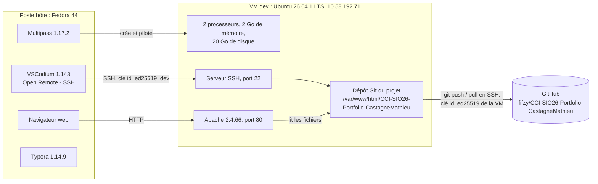

 
# AP1 - Portfolio - Documentation technique
 
**Date de création :** 25/11/2026 - M. Castagné
 
**Date de modification :** 27/11/2026 - M. Castagné
 
**Version :** 1.0
 
**Sommaire :**
 
> [TOC]
 
<div style="page-break-after:always"></div>
## 1. Objet du document
 
Ce document s’adresse à un technicien qui reprendrait mon portfolio. Il donne les langages et les logiciels utilisés avec leurs versions, explique comment est organisé mon environnement de développement et pourquoi j’ai choisi chaque outil. La partie 5 contient les commandes pour reconstruire cet environnement.
 
Les versions ont été relevées le 25/11/2026. La description de l’environnement de production et la procédure de mise en ligne seront ajoutées à la fin du projet.
 
## 2. Technologies et versions
 
### 2.1. Langages et formats
 
| Technologie | Utilisation dans le projet |
| --- | --- |
| HTML5 | Structure des pages |
| CSS3 | Mise en forme et adaptation aux écrans (responsive) |
| JavaScript | Quelques interactions, sans bibliothèque ni framework |
| SVG | Logo animé, icônes LinkedIn et GitHub |
| WOFF2 | Polices Shrikhand, Space Mono et DM Sans, hébergées avec le site |
| Markdown | Documentation du projet |
 
Le site est statique : pas de base de données, pas de langage côté serveur et pas d’outil de compilation comme npm. Apache sert directement les fichiers du dossier `html`. Un site de quelques pages n’a pas besoin de plus, et avec moins de dépendances, j’ai moins de mises à jour à suivre.
 
Tous les fichiers sont en UTF-8, avec des fins de ligne Unix (LF).
 
### 2.2. Logiciels
 
| Logiciel | Rôle | Version | Emplacement | Installation |
| --- | --- | --- | --- | --- |
| Fedora Linux | Système de mon poste de travail | 44 (noyau 7.2.15) | Hôte | - |
| Multipass | Création et gestion de la VM | 1.17.2 | Hôte | Snap, canal `latest/stable` |
| VSCodium | Éditeur de code | 1.143.17232 | Hôte | Flatpak (Flathub) |
| Open Remote - SSH | Extension de VSCodium pour travailler dans la VM | Dernière version | Hôte | Open VSX |
| Typora | Relecture des fichiers markdown et export PDF | 1.14.9 | Hôte | Flatpak (Flathub) |
| Git | Suivi de version | 2.56.1 | Hôte | dnf |
| OpenSSH (client) | Connexion à la VM | 10.2p1 | Hôte | dnf |
| Ubuntu Server | Système de la VM | 26.04.1 LTS (noyau 7.0.0) | VM | Image officielle Multipass |
| Apache HTTP Server | Serveur web de développement | 2.4.66 | VM | apt |
| Git | Suivi de version, envoi vers GitHub | 2.55.0 | VM | apt |
| OpenSSH (serveur) | Accès à distance à la VM | Celle d’Ubuntu 26.04 | VM | Préinstallé |
| PHP | Présent dans la VM, pas utilisé par le portfolio | 8.5.4 | VM | apt |
 
Le dépôt est sur GitHub : `fifzy/CCI-SIO26-Portfolio-CastagneMathieu`, branche `main`.
 
<div style="page-break-after:always"></div>
## 3. Architecture de l’environnement de développement
 
Je développe dans une machine virtuelle (VM) Ubuntu nommée `dev`, que j’ai créée avec Multipass sur mon ordinateur sous Fedora. Le projet est cloné dans la VM, dans le dossier publié par Apache.
 
Sur Fedora, j’ouvre ce dossier à distance avec VSCodium, par SSH. Quand je modifie un fichier ou que je lance une commande Git dans le terminal de VSCodium, tout se passe dans la VM. Pour tester le site, j’ouvre l’adresse de la VM dans le navigateur de Fedora. Les commits partent vers GitHub depuis la VM, avec une clé SSH qui lui est propre.
 

 
| Élément | Valeur |
| --- | --- |
| Nom de la VM | `dev` |
| Adresse IP de la VM | `10.58.192.71`, sur le réseau privé de Multipass, joignable seulement depuis l’hôte |
| Ressources de la VM | 2 processeurs, 2 Go de mémoire, 20 Go de disque |
| Accès SSH depuis l’hôte | `ssh dev` (alias défini dans `~/.ssh/config`) |
| Dossier du projet dans la VM | `/var/www/html/CCI-SIO26-Portfolio-CastagneMathieu` |
| Adresse du site en développement | `http://10.58.192.71/CCI-SIO26-Portfolio-CastagneMathieu/html/` |
 
Typora me sert à relire les fichiers markdown et à les exporter en PDF, avec l’en-tête et le pied de page définis au début de chaque document.
 
<div style="page-break-after:always"></div>
## 4. Choix des outils
 
### 4.1. Une VM créée avec Multipass
 
Mon ordinateur est sous Fedora, donc WSL, qui n’existe que sous Windows, n’était pas possible.
 
J’ai écarté Docker. Un conteneur fait tourner en général un seul service, sans gestionnaire de services ni SSH, alors que je voulais administrer un vrai serveur Linux. C’est d’ailleurs ce qui est évalué à l’oral de cet atelier.
 
Une VM classique, avec VirtualBox ou GNOME Boxes, aurait fonctionné. Mais il faut l’installer à la main depuis une image ISO, ce qui est long à refaire, et VirtualBox demande en plus des modules noyau sous Fedora.
 
J’ai donc choisi Multipass. Une seule commande crée une VM Ubuntu Server à partir de l’image officielle. Sous Linux, Multipass passe par QEMU et KVM, donc la VM tourne presque aussi vite que l’hôte. Tout se fait en ligne de commande, ce qui rend la procédure de la partie 5 facile à rejouer. Et si je casse quelque chose dans la VM, mon poste n’est pas touché : je peux la supprimer et la recréer.
 
### 4.2. Ubuntu Server 26.04 LTS
 
J’ai pris la dernière version LTS, celle que Multipass installe par défaut. Elle reçoit des mises à jour de sécurité pendant cinq ans, et beaucoup d’hébergeurs utilisent Ubuntu Server : mon environnement de développement est donc proche d’un vrai serveur.
 
### 4.3. Apache
 
J’utilise Apache parce que c’est le serveur web que nous étudions en cours et qu’il s’installe avec un seul paquet. Passer par un serveur, plutôt que d’ouvrir les fichiers HTML directement dans le navigateur, me permet de tester le site dans les mêmes conditions qu’en ligne. Par exemple, certains navigateurs bloquent le chargement des polices quand une page est ouverte en `file://`.
 
### 4.4. VSCodium et l’extension Open Remote - SSH
 
VSCodium est construit à partir du code de Visual Studio Code, mais sans la télémétrie de Microsoft, et il est sous licence libre (MIT). Je l’ai installé en Flatpak depuis Flathub.
 
Pour travailler dans la VM, j’utilise l’extension Open Remote - SSH, disponible sur Open VSX. L’extension Remote - SSH de Microsoft ne fonctionne qu’avec Visual Studio Code, à cause de sa licence. Avec Open Remote - SSH, je modifie les fichiers de la VM sans les copier sur Fedora, et le terminal intégré s’ouvre directement dans la VM.
 
### 4.5. Git et GitHub
 
Le sujet impose Git. Je fais un commit à chaque étape, ce qui garde l’historique de chaque fichier. GitHub sert de dépôt distant : c’est ma sauvegarde, et les formateurs peuvent y suivre l’avancement du projet. Je me connecte à GitHub avec une clé SSH, donc je n’ai ni mot de passe ni jeton à saisir.
 
### 4.6. Typora
 
Typora affiche le markdown mis en forme pendant que j’écris. Il l’exporte en PDF paginé, avec le titre, l’auteur et le numéro de page en pied de page, comme le demande le sujet.
 
<div style="page-break-after:always"></div>
## 5. Reconstruire l’environnement
 
Pour chaque étape, j’indique si les commandes se lancent sur l’hôte (terminal de Fedora) ou dans la VM (après `ssh dev`).
 
### 5.1. Installer les outils de l’hôte
 
Sur l’hôte :
 
```bash
sudo dnf install -y git snapd
sudo ln -s /var/lib/snapd/snap /snap
# fermer puis rouvrir la session pour que snap soit pris en compte
sudo snap install multipass
flatpak install -y flathub com.vscodium.codium io.typora.Typora
```
 
### 5.2. Créer la clé SSH de l’hôte
 
Sur l’hôte. Cette clé sert seulement à se connecter à la VM :
 
```bash
ssh-keygen -t ed25519 -f ~/.ssh/id_ed25519_dev
```
 
### 5.3. Créer la VM
 
Sur l’hôte :
 
```bash
multipass launch 26.04 --name dev --cpus 2 --memory 2G --disk 20G
multipass list
```
 
`multipass list` affiche l’adresse IP de la VM.
 
### 5.4. Autoriser la connexion SSH à la VM
 
Sur l’hôte, ajouter la clé publique de l’hôte aux clés autorisées de la VM :
 
```bash
multipass exec dev -- bash -c "echo '$(cat ~/.ssh/id_ed25519_dev.pub)' >> ~/.ssh/authorized_keys"
```
 
Puis ajouter cet alias dans `~/.ssh/config`, avec l’adresse IP donnée par `multipass list` :
 
```
Host dev
    HostName 10.58.192.71
    User ubuntu
    IdentityFile ~/.ssh/id_ed25519_dev
```
 
Enfin, protéger le fichier et tester la connexion :
 
```bash
chmod 600 ~/.ssh/config
ssh dev
```
 
### 5.5. Installer Apache et Git dans la VM
 
Dans la VM :
 
```bash
sudo apt update && sudo apt full-upgrade -y
sudo apt install -y apache2 git
systemctl status apache2
```
 
### 5.6. Préparer le dossier web
 
Dans la VM. L’utilisateur `ubuntu` devient propriétaire du dossier publié par Apache, pour pouvoir y travailler sans `sudo` (détails dans la partie 6) :
 
```bash
sudo chown ubuntu:ubuntu /var/www/html
sudo chmod 2775 /var/www/html
```
 
### 5.7. Relier la VM à GitHub
 
Dans la VM, créer une clé SSH propre à la VM et afficher sa partie publique :
 
```bash
ssh-keygen -t ed25519
cat ~/.ssh/id_ed25519.pub
```
 
Ajouter cette clé sur GitHub, dans *Settings > SSH and GPG keys > New SSH key*. Ensuite, tester la connexion et configurer l’identité Git :
 
```bash
ssh -T git@github.com
git config --global user.name "fifzy"
git config --global user.email "mathieu.castagne@ccicampus.fr"
```
 
### 5.8. Cloner le projet
 
Dans la VM :
 
```bash
cd /var/www/html
git clone git@github.com:fifzy/CCI-SIO26-Portfolio-CastagneMathieu.git
```
 
### 5.9. Sécuriser la VM
 
Dans la VM, activer le pare-feu, puis interdire l’accès web aux dossiers `.git` :
 
```bash
sudo ufw allow OpenSSH
sudo ufw allow Apache
sudo ufw --force enable
 
echo '<DirectoryMatch "/\.git">
    Require all denied
</DirectoryMatch>' | sudo tee /etc/apache2/conf-available/bloquer-git.conf
sudo a2enconf bloquer-git
sudo systemctl reload apache2
```
 
Attention à l’ordre : il faut autoriser le port 22 avant d’activer le pare-feu, sinon ni `ssh dev` ni Multipass ne peuvent plus se connecter à la VM.
 
Pour vérifier le blocage, `curl -I http://localhost/CCI-SIO26-Portfolio-CastagneMathieu/.git/HEAD` doit répondre `403 Forbidden`.
 
### 5.10. Configurer VSCodium
 
Sur l’hôte :
 
1. Installer l’extension Open Remote - SSH depuis le panneau des extensions de VSCodium.
2. Dans l’explorateur distant, choisir l’hôte `dev`. VSCodium lit l’alias de `~/.ssh/config`.
3. Ouvrir le dossier `/var/www/html/CCI-SIO26-Portfolio-CastagneMathieu`.
Le terminal intégré de VSCodium s’ouvre alors dans la VM.
 
### 5.11. Vérifier
 
Dans le navigateur de l’hôte, ouvrir `http://10.58.192.71/CCI-SIO26-Portfolio-CastagneMathieu/html/`.
 
Pour copier un fichier de l’hôte vers la VM, par exemple une image pour la documentation, lancer sur l’hôte :
 
```bash
multipass transfer image.png dev:/var/www/html/CCI-SIO26-Portfolio-CastagneMathieu/documentation/medias/
```
 
<div style="page-break-after:always"></div>
## 6. Droits d’accès
 
### 6.1. Comptes utilisés
 
Trois comptes de la VM sont concernés :
 
| Compte | Rôle |
| --- | --- |
| `ubuntu` | Mon compte de travail. Il fait partie des groupes `sudo` (administration) et `adm` (lecture des journaux). |
| `www-data` | Compte d’Apache. Il doit pouvoir lire les fichiers du site, mais pas les modifier. |
| `root` | Administrateur, utilisé seulement à travers `sudo`. |
 
### 6.2. Dossiers du site
 
| Chemin | Propriétaire : groupe | Droits |
| --- | --- | --- |
| `/var/www` | `root` : `adm` | `drwxrwsr-x` (2775) |
| `/var/www/html` | `ubuntu` : `ubuntu` | `drwxrwsr-x` (2775) |
| `/var/www/html/CCI-SIO26-Portfolio-CastagneMathieu` | `ubuntu` : `ubuntu` | `drwxrwsr-x` (2775) |
 
Pour lire 2775 : r (lecture) vaut 4, w (écriture) vaut 2 et x (exécution, ou accès pour un dossier) vaut 1. Le premier chiffre, 2, est le bit setgid. Viennent ensuite 7 (rwx) pour le propriétaire, 7 (rwx) pour le groupe et 5 (r-x) pour les autres.
 
En pratique :
 
- Apache tourne sous `www-data`, qui n’est ni propriétaire ni dans le groupe. Il a donc les droits des « autres » : lecture et accès, sans écriture. Il peut servir le site, mais pas modifier les fichiers, même si quelqu’un prenait le contrôle du serveur web.
- Le bit setgid (le `s` à la place du `x` du groupe) fait que chaque nouveau fichier prend le groupe du dossier où il est créé.
- Comme `ubuntu` est propriétaire du projet, je travaille sans `sudo`.
Avec le masque par défaut d’Ubuntu (umask 002), les nouveaux fichiers sont créés en 664 (`rw-rw-r--`) et les nouveaux dossiers en 2775. Pour remettre ces droits sur tout le projet :
 
```bash
cd /var/www/html/CCI-SIO26-Portfolio-CastagneMathieu
find . -path ./.git -prune -o -type d -exec chmod 2775 {} +
find . -path ./.git -prune -o -type f -exec chmod 664 {} +
```
 
### 6.3. Fichiers SSH
 
OpenSSH refuse d’utiliser une clé privée que d’autres utilisateurs peuvent lire. Ces droits sont donc obligatoires, sur l’hôte comme dans la VM :
 
| Fichier | Droits | Raison |
| --- | --- | --- |
| `~/.ssh` | `drwx------` (700) | Seul le propriétaire entre dans le dossier |
| Clés privées (`id_ed25519_dev`, `id_ed25519`) | `-rw-------` (600) | Secrètes |
| Clés publiques (`.pub`) | `-rw-r--r--` (644) | Pas secrètes |
| `authorized_keys` (VM) | `-rw-------` (600) | Clés autorisées à se connecter au compte `ubuntu` |
| `config` (hôte) | `-rw-------` (600) | Alias de connexion |
 
<div style="page-break-after:always"></div>
## 7. Organisation des répertoires et conventions
 
### 7.1. Arborescence du projet
 
Le dépôt reprend l’arborescence demandée par le sujet :
 
```
CCI-SIO26-Portfolio-CastagneMathieu
├── .git
├── documentation
│   ├── charte.md
│   ├── contenu.md
│   ├── technique.md
│   └── medias
├── html
│   ├── assets
│   │   ├── css
│   │   │   └── style.css
│   │   ├── fonts
│   │   ├── img
│   │   └── js
│   │       └── main.js
│   ├── index.html
│   └── *.html
└── README.md
```
 
| Dossier ou fichier | Contenu |
| --- | --- |
| `documentation` | Dossier d’étude : contenu, charte graphique et documentation technique |
| `documentation/medias` | Images des trois documents (maquettes, wireframes, schémas) |
| `html` | Le site lui-même, seul dossier qui sera publié |
| `html/assets/css` | Feuille de style `style.css` |
| `html/assets/fonts` | Polices WOFF2 |
| `html/assets/img` | Images du site, logo et icônes |
| `html/assets/js` | Script `main.js` |
| `html/*.html` | Une page HTML par page du site, `index.html` pour l’accueil |
| `README.md` | Présentation du projet sur GitHub |
 
### 7.2. Conventions
 
Le sujet impose les guidelines Kiwipedia de l’agence Alsacréations. Voici celles qui s’appliquent à ce projet.
 
Nommage :
 
- les fichiers et les dossiers du site sont en anglais, en minuscules, sans accent ni espace ;
- les fichiers qui apparaissent dans les adresses, ainsi que les classes CSS, sont en kebab-case (mots séparés par un tiret), par exemple `legal-notice.html`. Le tiret bas (snake_case) n’est pas utilisé ;
- les variables et les fonctions JavaScript sont en camelCase, par exemple `toggleMenu` ;
- le code qui reste à faire est signalé par `TODO:` ou `FIXME:`.
Écriture du code :
 
- encodage UTF-8 sans BOM et fins de ligne LF ;
- indentation de 2 espaces ;
- HTML en minuscules, avec des guillemets doubles, vérifié avec le validateur du W3C.
Quand le sujet et Kiwipedia ne disent pas la même chose, je suis le sujet. Par exemple, la routine de démarrage de Kiwipedia nomme la feuille de style `styles.css`, mais le sujet impose `style.css`.
 
Les images du dossier `documentation/medias` ne sont pas publiées sur le site. Elles ont été nommées avant que je mette en place ces règles et gardent leur nom, pour ne pas casser les liens des documents.
 
Pour Git, Kiwipedia demande des messages de commit en français, à l’impératif, au format `type(portée): description`. Par exemple : `docs(technique): ajoute la partie sécurité` ou `feat(accueil): ajoute la zone du logo`. La branche `main` est la branche de référence, puisque c’est la seule évaluée.
 
### 7.3. Emplacement dans la VM
 
```
/var/www/html                                  racine web d’Apache
├── CCI-SIO26-Portfolio-CastagneMathieu        ce projet
├── cours_html                                 dépôt d’un autre cours
└── index.html                                 page par défaut d’Apache
```
 
Apache publie tout le contenu de `/var/www/html`. Chaque projet est donc accessible à l’adresse `http://10.58.192.71/` suivie du nom de son dossier, et le site du portfolio se trouve dans le sous-dossier `html`.
 
<div style="page-break-after:always"></div>
## 8. Sécurité
 
### 8.1. Accès à la VM
 
La VM n’accepte que les connexions par clé : la connexion par mot de passe est désactivée (`PasswordAuthentication no`) et root ne peut pas se connecter avec un mot de passe (`PermitRootLogin prohibit-password`).
 
Mes clés sont de type Ed25519 et chacune a un seul usage : `id_ed25519_dev` pour aller de Fedora à la VM, `id_ed25519` pour aller de la VM à GitHub. Aucune clé privée n’est copiée d’une machine à l’autre. Si l’une d’elles est volée, je peux la révoquer sans toucher à l’autre.
 
### 8.2. Réseau et pare-feu
 
La VM est sur le réseau privé de Multipass : on ne peut la joindre que depuis mon poste, pas depuis Internet ni depuis le réseau local. Seuls SSH (port 22) et Apache (port 80) sont ouverts, et le pare-feu ufw bloque tout le reste. Un service installé par erreur resterait donc inaccessible.
 
### 8.3. Serveur web
 
Apache refuse l’accès aux dossiers `.git` grâce à la configuration `bloquer-git` (partie 5.9). Sans elle, n’importe qui pourrait télécharger l’historique du dépôt. Apache ne peut que lire les fichiers du site (partie 6), et la racine web ne contient aucun fichier de test, comme une page qui afficherait la configuration de PHP.
 
### 8.4. Mises à jour
 
Je mets la VM à jour avec `sudo apt update && sudo apt full-upgrade`. Ubuntu installe aussi tout seul les correctifs de sécurité, grâce au paquet `unattended-upgrades`. Sur Fedora, j’utilise `sudo dnf upgrade`, `flatpak update` et `sudo snap refresh`.
 
### 8.5. Données personnelles
 
Les polices sont hébergées avec le site au lieu d’être chargées depuis Google Fonts, et le site n’utilise ni CDN, ni script externe, ni outil de statistiques, ni cookie. Aucune donnée de visite ne part chez un tiers, ce qui simplifie le respect du RGPD. Le dépôt ne contient ni mot de passe ni clé privée.
 
### 8.6. Sauvegarde
 
GitHub garde une copie du dépôt et de tout son historique à chaque `git push`.
 
Avant une modification risquée de la VM, je prends un instantané (snapshot) pour pouvoir revenir en arrière. Sur l’hôte :
 
```bash
multipass stop dev
multipass snapshot dev --name avant-modification
multipass start dev
```
 
Pour revenir à l’instantané, la VM étant arrêtée : `multipass restore dev.avant-modification`.
 
### 8.7. Limite de l’environnement de développement
 
Dans la VM, `ubuntu` peut utiliser `sudo` sans mot de passe : c’est le réglage par défaut de Multipass. Pour une VM locale sans données sensibles, c’est acceptable, mais il ne faudra pas garder ce réglage en production.
 
<div style="page-break-after:always"></div>
## 9. Environnement de production et mise en ligne
 
Cette partie sera rédigée à la fin du projet, au moment de la mise en ligne (rendu 5). Elle décrira l’environnement de production et la procédure pour y transférer le site.
 
Seul le dossier `html` sera publié : la documentation et l’historique Git ne seront pas accessibles en ligne.
 
